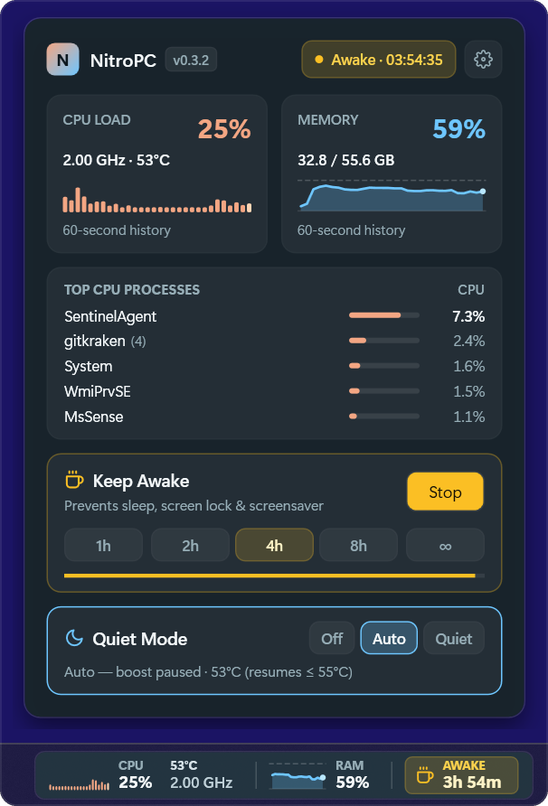

<p align="center">
  
</p>

# NitroPC

**Native Windows 11 taskbar toolbox with real-time CPU, clock, temperature & RAM gauges, top CPU processes, silent Keep Awake, and thermal Auto Quiet Mode.**

[](https://github.com/magnuslandahl/NitroPC/actions/workflows/ci.yml)

**[Download Windows x64 Installer](https://github.com/magnuslandahl/NitroPC/releases/latest/download/NitroPC-win-x64-Setup.exe)** ·
[Windows ARM64 Installer](https://github.com/magnuslandahl/NitroPC/releases/latest/download/NitroPC-win-arm64-Setup.exe) ·
[Latest release](https://github.com/magnuslandahl/NitroPC/releases/latest) ·
[Checksums (`SHA256SUMS.txt`)](https://github.com/magnuslandahl/NitroPC/releases/latest/download/SHA256SUMS.txt)

<p align="center">
  
</p>

## Features

- **Taskbar Strip & Notification Area**: Docks cleanly to the left of Windows 11 Weather/Widgets and the system tray via UI Automation obstacle scanning, binds ownership to `Shell_TrayWnd` to prevent Z-order flicker on taskbar clicks, and auto-hides for real fullscreen apps on the same monitor. Uses a locked 2-row tabular grid (`CPU / %`, `°C / GHz`, `RAM / %`, `AWAKE / remaining`) and **automatically compacts through 5 progressive layouts** (`Full` → `Compact Graphs` → `Readouts Only` → `Mini` → `36px Icon Pill`) as taskbar space tightens, plus an always-available **Notification Area (system tray) icon** that opens the Toolbox popup above the tray even if the taskbar has zero room left.
- **CPU, Memory & Top Processes**: Samples every 2s into a 60-second progressive window. Displays total CPU `%`, activity-weighted effective clock (`GHz`), ACPI thermal-zone temperature (`°C`), selectable 60s **History** bars (default) or per-core bars, a dynamic-range RAM sparkline (`%`, `GB`, or `% + GB`), and the **Top 5 CPU Processes** (aggregating multi-process apps via `NtQuerySystemInformation` while keeping separate `svchost` hosts distinct).
- **Silent Keep Awake**: Combines `SetThreadExecutionState` (blocks OS sleep, screen lock, and screensaver) with a 60-second `VK_F15` activity pulse (prevents idle status without toggling NumLock/ScrollLock LEDs). Includes `1h`, `2h`, `4h`, `8h`, and `∞` presets, middle-click strip toggle, system tray menu controls, and automatic restoration across app restarts and Windows reboots.
- **3-State Quiet Mode (`Off` | `Auto` | `Quiet`)**: Adjusts the active Windows power plan's AC/DC `Processor performance boost mode` (`PERFBOOSTMODE`) without administrator elevation or OEM fan-curve writes. `Auto` disables turbo boost at `60°C` (default), `70°C`, or `80°C` and restores it after cooling by `5°C` with a 15-second minimum hold; `Quiet` keeps boost off continuously. Original power settings are persisted prior to modification, restored on exit, and recovered automatically after crashes or reboots.
- **Settings, Startup & Persistence**: Clicking the header gear smoothly expands a right-hand **Settings** drawer alongside live telemetry (`History`/`Cores`, `%`/`GB`/`% + GB`, `Badge`/`Icon`/`Hide`, `60°C`/`70°C`/`80°C`, `Start with Windows` via `HKCU\...\Run`, and update controls). Configuration is written atomically (`WriteThrough` + `.tmp` swap) to `%LOCALAPPDATA%\NitroPC\settings.json`.
- **Verified Self-Updates**: Queries GitHub Releases metadata, binds downloads to immutable asset IDs, validates declared byte size and `SHA256SUMS.txt` digest before extraction, and swaps binaries out-of-process via `NitroPC.Updater.exe` with automatic rollback on failure.

## Install & Update

Everything is bundled inside the installer (self-contained `.NET 10` runtime — nothing else to install, and no administrator elevation required). The installer places NitroPC in `%LOCALAPPDATA%\Programs\NitroPC`, adds a Start Menu shortcut and Windows **Installed apps** entry, optionally enables **Start with Windows**, and launches the taskbar strip.

| Platform | Installer (Recommended) | Portable / Update ZIP | First launch |
| --- | --- | --- | --- |
| **Windows 11 x64** | [`NitroPC-win-x64-Setup.exe`](https://github.com/magnuslandahl/NitroPC/releases/latest/download/NitroPC-win-x64-Setup.exe) | [`NitroPC-win-x64.zip`](https://github.com/magnuslandahl/NitroPC/releases/latest/download/NitroPC-win-x64.zip) | Open the installer. At **Windows protected your PC**, choose **More info → Run anyway**, then finish setup. |
| **Windows 11 ARM64** | [`NitroPC-win-arm64-Setup.exe`](https://github.com/magnuslandahl/NitroPC/releases/latest/download/NitroPC-win-arm64-Setup.exe) | [`NitroPC-win-arm64.zip`](https://github.com/magnuslandahl/NitroPC/releases/latest/download/NitroPC-win-arm64.zip) | Same as x64. |

Verify any download against [`SHA256SUMS.txt`](https://github.com/magnuslandahl/NitroPC/releases/latest/download/SHA256SUMS.txt) (`Get-FileHash .\NitroPC-win-x64-Setup.exe -Algorithm SHA256`). Subsequent releases install in place from **Settings → Check for updates** (or the tray menu) after confirmation.

## Architecture & Privacy

Built on `.NET 10` WPF with direct Win32, NT, Power, and PDH P/Invoke (`ntdll`, `kernel32`, `user32`, `dwmapi`, `powrprof`, `pdh`) and zero external production NuGet dependencies. All telemetry and process sampling stays local on your machine; no accounts, analytics, or telemetry exist, and network requests occur only when checking or downloading GitHub Releases updates.

## Build from Source

```powershell
dotnet build NitroPC.sln -c Release
dotnet test NitroPC.sln -c Release --nologo
dotnet run --project src\NitroPC\NitroPC.csproj -c Release
```

[Auto-update & release verification](docs/AUTO_UPDATE.md) · [UI specification](docs/UI_SPEC.md)

The repository's social preview card is [`docs/images/social-preview.png`](docs/images/social-preview.png) (`1280 × 640`). GitHub does not read it automatically from the repository; upload it under **Settings → General → Social preview**.

