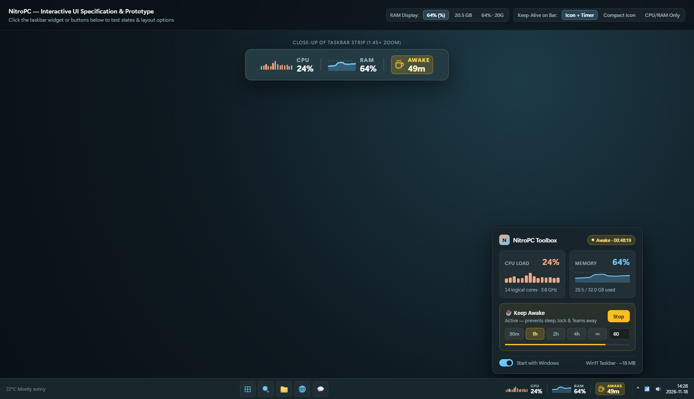
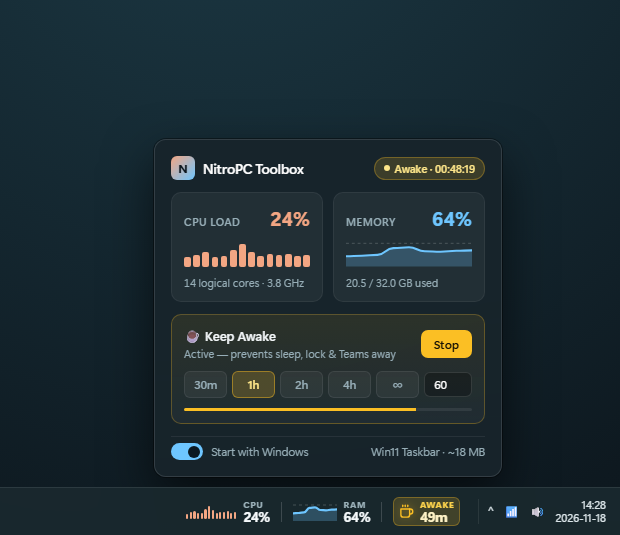

# NitroPC

A lightweight, native Windows 11 taskbar toolbox showing real-time **CPU** and **RAM** gauges alongside **Keep-Alive ("Kaffe")**, Quiet Mode, and Windows startup controls.



## Features

- **Windows 11 Taskbar Strip**: Docked in a collision-free space next to the system tray (auto-hides during fullscreen apps/games), with fixed-width readouts that do not jump as percentages change:
  - **CPU Gauge**: Select up to 24 logical-core coral bars or a 24-second history, plus live total CPU `%`.
  - **Memory Gauge**: Sky-blue area sparkline (`#6EC6FF`) with a highlighted newest point and configurable `%`, `GB`, or `% · GB` readout.
  - **Keep-Alive Badge**: Live amber `☕ AWAKE` countdown pill (configurable as `Icon + Timer`, `Compact Icon`, or `Hidden`).
- **Windows 11 Toolbox Flyout**: Click the taskbar strip to open a dark translucent flyout with detailed CPU/RAM cards and one-click Keep-Awake presets. A gear button reveals display, startup, automatic-update, and Quit controls.
- **Smart Keep-Alive Engine**: Upgrades legacy `Kaffe` by combining `SetThreadExecutionState` (prevents OS sleep & display lock) with a silent 60-second `VK_F15` activity pulse (keeps Teams/Slack active without flashing keyboard NumLock LEDs).
- **Reversible Quiet Mode**: Temporarily disables the Windows processor boost policy for both AC and battery operation to reduce heat/fan demand. It records the original policy before changing it, restores it on exit, and recovers it after an interrupted session. It does not claim direct control of OEM fan curves.
- **Zero-Bloat Native Stack**: Built with `.NET 10` WPF + direct Win32 P/Invoke (`NtQuerySystemInformation`, `GlobalMemoryStatusEx`, `SendInput`) with zero external production NuGet dependencies.
- **Automatic Updates**: Checks the latest GitHub release, verifies an immutable
  architecture-specific ZIP against `SHA256SUMS.txt`, and restarts through a
  separate updater process after user approval.

## Visual Previews

| Taskbar Strip (Awake) | Taskbar Strip (Idle) |
| --- | --- |
|  |  |

| Toolbox Flyout + Taskbar |
| --- |
|  |

## Documentation & Implementation Blueprint

- **[`AGENTS.md`](AGENTS.md)** — Mandatory rules, build/test commands, and Win32/WPF pitfalls to avoid for coding agents.
- **[`docs/IMPLEMENTATION_PLAN.md`](docs/IMPLEMENTATION_PLAN.md)** — Ordered Phase 1–7 step-by-step implementation guide, target folder structure, verified Win32 P/Invoke structs, and test plan.
- **[`docs/UI_SPEC.md`](docs/UI_SPEC.md)** — Complete UI specification, exact WPF `#AARRGGBB` color tokens, typography, vector paths, and interaction rules.
- **[`docs/ui-preview.html`](docs/ui-preview.html)** — Interactive HTML/CSS/SVG UI prototype (open in any browser to test layouts and states).
- **[`docs/AUTO_UPDATE.md`](docs/AUTO_UPDATE.md)** — Release format, checksum
  verification, staging, restart, and recovery behavior.

## Build and run

Requires the .NET 10 SDK to build and the .NET 10 Windows Desktop Runtime to run
a published framework-dependent build.

```powershell
dotnet build NitroPC.sln
dotnet test NitroPC.sln --nologo
dotnet run --project src\NitroPC\NitroPC.csproj
```

The release workflow publishes `NitroPC-win-x64.zip` and
`NitroPC-win-arm64.zip` plus `SHA256SUMS.txt`. Extract the ZIP for your
architecture to `%LOCALAPPDATA%\Programs\NitroPC` and run `NitroPC.exe`.

