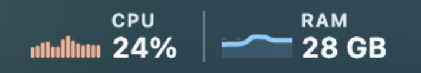

# NitroPC — UI & Visual Specification

This document defines the exact visual design, layout metrics, colors, icons, and interaction states for **NitroPC**.

> **Interactive Reference**: Open [`docs/ui-preview.html`](ui-preview.html) in any browser to inspect spacing, animations, and interactive toggles live.

---

## 1. Visual Reference Gallery

### Original Inspiration (CPU + RAM Strip)


### NitroPC Taskbar Strip — Awake State (`1.45×` Close-Up)


### NitroPC Taskbar Strip — Idle State (`1.45×` Close-Up)


### NitroPC Toolbox Flyout + Docked Windows 11 Taskbar


### Full Concept Overview — Awake vs Idle
| Awake State | Idle State |
| --- | --- |
|  |  |

---

## 2. Color Tokens (Exact WPF `#AARRGGBB` Values)

> **WARNING FOR WPF XAML**: WPF uses `#AARRGGBB` (Alpha channel first!), **NOT** CSS `#RRGGBBAA`. Copy the **WPF XAML Hex** column directly into `Themes/NitroTheme.xaml`.

| Token Name | Purpose | CSS Equivalent | WPF XAML Hex (`#AARRGGBB`) |
| --- | --- | --- | --- |
| `StripBackgroundBrush` | Taskbar strip pill background (subtle translucent dark slate) | `rgba(35, 56, 64, 0.85)` | `#D9233840` |
| `StripHoverBrush` | Taskbar strip hover background | `rgba(48, 74, 84, 0.92)` | `#EB304A54` |
| `StripBorderBrush` | Subtle 1px border on strip | `rgba(255, 255, 255, 0.10)` | `#1AFFFFFF` |
| `FlyoutBackgroundBrush` | Main flyout window background | `rgba(24, 36, 43, 0.96)` | `#F518242B` |
| `FlyoutBorderBrush` | Main flyout 1px outer border | `rgba(255, 255, 255, 0.14)` | `#24FFFFFF` |
| `CardBackgroundBrush` | Inner telemetry / Keep Awake card fill | `rgba(255, 255, 255, 0.05)` | `#0DFFFFFF` |
| `CardBorderBrush` | Inner card 1px border | `rgba(255, 255, 255, 0.07)` | `#12FFFFFF` |
| `DividerBrush` | Vertical 1px separator on taskbar strip | `rgba(255, 255, 255, 0.16)` | `#29FFFFFF` |
| `TextPrimaryBrush` | Primary metric numbers & titles | `#F3F7F9` | `#FFF3F7F9` |
| `TextMutedBrush` | Uppercase labels (`CPU`, `RAM`) & subtitles | `#97AEB7` | `#FF97AEB7` |
| `CpuCoralBrush` | CPU vertical bars & CPU % highlight | `#F3A683` | `#FFF3A683` |
| `CpuLatestBrush` | Newest CPU history bar | `#FFD6B5` | `#FFFFD6B5` |
| `RamBlueBrush` | RAM sparkline stroke, RAM %, active switch | `#6EC6FF` | `#FF6EC6FF` |
| `RamLatestBrush` | Newest RAM history sample | `#B8E7FF` | `#FFB8E7FF` |
| `RamFillBrush` | RAM sparkline area fill under curve | `rgba(110, 198, 255, 0.25)` | `#406EC6FF` |
| `SparkGuideBrush` | Top dashed ceiling guide line in RAM sparkline | `rgba(255, 255, 255, 0.20)` | `#33FFFFFF` |
| `KaffeAmberBrush` | Active Keep-Awake icon, progress bar & Stop button | `#FBBF24` | `#FFFBBF24` |
| `KaffeGlowFillBrush` | Active Keep-Awake badge background | `rgba(251, 191, 36, 0.18)` | `#2EFBBF24` |
| `KaffeGlowBorderBrush` | Active Keep-Awake badge border | `rgba(251, 191, 36, 0.35)` | `#59FBBF24` |
| `KaffeLabelAwakeBrush` | `AWAKE` small label when active | `#FCD34D` | `#FFFCD34D` |
| `KaffeValueAwakeBrush` | `49m` / `∞` value text when active | `#FEF3C7` | `#FFFEF3C7` |
| `KaffeIdleIconBrush` | Coffee cup icon when idle | `#7E969F` | `#FF7E969F` |

---

## 3. Component Dimensions & Typography (in WPF DIPs)

- **Font Family**: `Segoe UI Variable Display, Segoe UI`
- **Numeric alignment**: Use `Typography.NumeralAlignment="Tabular"` on metric `TextBlock` elements so percentages don't jitter horizontally as numbers change.

### A. Taskbar Strip (`TaskbarStripWindow`)
- **Outer Window Height**: Matches taskbar height dynamically (on standard Windows 11 taskbar = `48` DIPs; inner pill height = `36` DIPs, vertically centered, `CornerRadius="7"`, horizontal padding `10,0`).
- **Width**: `SizeToContent="Width"` with fixed-width metric text columns so changing values never move the neighboring charts.
- **Dock anchor**: `TaskbarObstacleScanner` queries Windows UI Automation button bounds inside `Shell_TrayWnd` on a background loop so `TaskbarLayout.FindRightAnchoredSlot` places the strip immediately to the left of `Widgets`/Weather and `TrayNotifyWnd` while never overlapping pinned or running app icons.
- **Horizontal Element Sequence** (gap `10` DIPs between sections):
  1. **CPU Unit**:
     - `CpuBarsControl`: `Width="48"`, `Height="18"`, up to **20 vertical rounded bars** on the strip (`30` in the flyout). The chart is bottom-aligned with the metric readout.
       - **History (default)**: progressively loads 2-second total-CPU samples from right to left and highlights the newest bar with `CpuLatestBrush`.
       - **Cores**: shows logical cores directly; systems with more logical cores than bar slots are grouped.
     - Stacked Text (`Margin="7,0,0,0"`):
       - Top: `CPU` (`FontSize="9"`, `FontWeight="Bold"`, `Foreground="{StaticResource TextMutedBrush}"`)
       - Bottom: `24%` (`FontSize="13.5"`, `FontWeight="Bold"`, `Foreground="{StaticResource TextPrimaryBrush}"`)
  2. **Divider 1**: `Border` `Width="1"`, `Height="20"`, `Background="{StaticResource DividerBrush}"`.
  3. **RAM Unit**:
     - `RamSparklineControl`: `Width="44"`, `Height="18"`:
       - Top dashed horizontal guide line (`StrokeThickness = 1`, dash `3,3`, `SparkGuideBrush`) and subtle bottom baseline.
       - Right-aligned progressive polyline of 2-second RAM % samples with dynamic Y-windowing (minimum `2.5%` span) and the latest point highlighted by `RamLatestBrush`.
     - Stacked Text (`Margin="7,0,0,0"`):
       - Top: `RAM` (`FontSize="9"`, `FontWeight="Bold"`, `Foreground="{StaticResource TextMutedBrush}"`)
       - Bottom (`RamDisplayMode` setting):
         - `Percent` (default): `64%`
         - `Gigabytes`: `21 GB` (or `20.5 GB`)
         - `Both`: `64% · 21G`
  4. **Divider 2** (hidden when `KeepAwakeBarMode == Hidden`): `Width="1"`, `Height="20"`.
  5. **Keep-Alive ("Kaffe") Slot** (controlled by `KeepAwakeBarMode`):
     - `Badge` (default): Pill `CornerRadius="6"`, `Padding="6,3"`:
       - **When Awake**: `Background="{StaticResource KaffeGlowFillBrush}"`, `BorderBrush="{StaticResource KaffeGlowBorderBrush}"`, `BorderThickness="1"`, amber coffee icon (`15×15`), `AWAKE` (`FontSize="8.5"`, `KaffeLabelAwakeBrush`) over remaining minutes (`49m`, `2h 15m`, or `∞`, `FontSize="13"`, `KaffeValueAwakeBrush`).
       - **When Idle**: `Background="Transparent"`, `BorderBrush="Transparent"`, muted coffee icon (`KaffeIdleIconBrush`), `IDLE` (`TextMutedBrush`) over `Off` (`TextPrimaryBrush`).
     - `CompactIcon`: Shows only the `15×15` coffee icon (amber glow when Awake, muted gray when Idle) with tooltip showing remaining time.
     - `Hidden`: Hides Divider 2 and Keep-Alive slot on the taskbar strip (controlled via Flyout / Tray icon).

### Coffee Cup Vector Path (WPF `Path.Data`)
Use a `Viewbox` (`Width="15" Height="15"`) containing a `Canvas` (`Width="24" Height="24"`) with this exact stroke path (`StrokeThickness="2.2"`, `StrokeStartLineCap="Round"`, `StrokeEndLineCap="Round"`):
```xml
<Viewbox Width="15" Height="15">
    <Canvas Width="24" Height="24">
        <Path Data="M 17,8 H 18 A 4,4 0 1 1 18,16 H 17 M 3,8 H 17 V 17 A 4,4 0 0 1 13,21 H 7 A 4,4 0 0 1 3,17 Z M 6,2 V 4 M 10,2 V 4 M 14,2 V 4"
              Stroke="{Binding ...}"
              StrokeThickness="2.2"
              StrokeStartLineCap="Round"
              StrokeEndLineCap="Round"
              StrokeLineJoin="Round" />
    </Canvas>
</Viewbox>
```

---

### B. Toolbox Flyout (`ToolboxFlyoutWindow`)
- **Size**: Collapsed card `Width="368"` (`336` inner column), expanding smoothly to `Width="668"` (`+300` right Settings drawer) with a `220ms` `CubicEase` animation; `Background="{x:Null}"` keeps unused layered window space click-through.
- **Anchor Position**: `10` DIPs above the top of the Windows taskbar, with the collapsed card right-aligned to `TaskbarStripWindow` so opening Settings expands cleanly to the right (shifting left smoothly only if needed to stay inside `Screen.WorkingArea`).
- **Sections** (`10–12` DIP vertical spacing):
  1. **Header Row (`Height="28"`)**:
     - Left: `24×24` rounded gradient badge (`#FFF3A683` -> `#FF6EC6FF`, bold dark `N`) + `NitroPC` (`FontSize="13.5"`, `FontWeight="SemiBold"`) + `vX.Y.Z` version pill.
     - Right: `StatusChip` is hidden when Idle, and shown at `Height="28"`, `CornerRadius="7"` (`● Awake · 03:59:59`) when active so it matches the `28×28` (`CornerRadius="7"`) gear button beside it.
  2. **2-Column Telemetry Grid** (`Gap = 10` DIPs):
     - **Left Card — CPU Load**:
       - Header: `CPU LOAD` + large coral `24%` (`FontSize="20"`, `FontWeight="Bold"`).
       - Live sensors line: `{FrequencyGhz:0.00} GHz · {TempC:0}°C`.
       - Graph: `CpuBarsControl` (`Height="26"`, up to 30 bars).
       - Subtitle: `60-second history` (default) or `{CoreCount} logical cores`.
     - **Right Card — Memory**:
       - Header: `MEMORY` + large sky-blue `64%` (`FontSize="20"`, `FontWeight="Bold"`).
       - Live usage line: `{UsedGb:0.0} / {TotalGb:0.0} GB`.
       - Graph: `RamSparklineControl` (`Height="26"`, up to 30 history samples with dynamic Y-windowing).
       - Subtitle: `60-second history`.
  3. **Top CPU Processes Card**:
     - Displays the top 5 most CPU-intensive processes (`NtQuerySystemInformation(SystemProcessInformation)`), grouping multi-process apps (`msedge (4)`), with proportional coral activity bars and tabular `%`.
  4. **Keep Awake ("Kaffe") Card**:
     - Highlighted border (`KaffeGlowBorderBrush`) when active.
     - Top row: `☕ Keep Awake` title + status subtitle (`Prevents sleep, screen lock & screensaver` vs `Off — normal sleep & screen lock`) + **Start / Stop** button (`#FFFBBF24` amber background with dark text `#FF171205` when Awake; subtle `#1AFFFFFF` button with white text when Idle).
     - Preset row: 5 equal-width preset buttons (`1h`, `2h`, `4h`, `8h`, `∞`). Clicking any preset immediately starts Keep Awake for that duration!
     - Countdown progress bar (`Height="3"`, fills proportionally `remaining / total`, `100%` when `∞`, `0%` when Idle).
  5. **Quiet Mode Card (`Off` | `Auto` | `Quiet`)**:
     - Vector crescent-moon icon + 3-state segmented selector:
       - `Off`: normal Windows CPU boost.
       - `Auto`: disables boost when CPU temperature reaches the configured threshold (`60°C` default / `70°C` / `80°C`) and restores boost after cooling down (`5°C` hysteresis + 15s minimum hold).
       - `Quiet`: always disables Windows processor boost on AC and battery power while active.
  6. **Right-Expanding Settings Drawer (toggled via header gear)**:
     - Slides open (`0 -> 300` DIPs) to the right of a vertical `1px` divider while keeping the left Toolbox cards visible.
     - **TASKBAR DISPLAY** card (all leftmost options are the defaults):
       - **CPU graph**: `History` | `Cores` (`History` default)
       - **RAM readout**: `%` | `GB` | `% + GB` (`%` default)
       - **Keep Awake**: `Badge` | `Icon` | `Hide` (`Badge` default)
       - **Auto Quiet**: `60°C` | `70°C` | `80°C` (`60°C` default)
     - **SYSTEM & UPDATES** card:
       - **Start with Windows** and **Check updates automatically** switches + **Check for updates** button.
     - **Footer**: Prominent **Quit NitroPC** power button.

---

## 4. Mouse & Tray Interactions
- **Left-click anywhere on `TaskbarStripWindow`**: Opens/closes `ToolboxFlyoutWindow`.
- **Middle-click on `TaskbarStripWindow`** (shortcut): Toggles Keep-Awake On/Off using the last saved duration!
- **Right-click on `TaskbarStripWindow` OR System Tray Icon**: Opens quick context menu:
  - `Open NitroPC Toolbox`
  - `Keep Awake: 1 Hour` / `2 Hours` / `Indefinite (∞)` / `Stop Keep Awake`
  - `Start with Windows` (checkable)
  - `Exit NitroPC`
